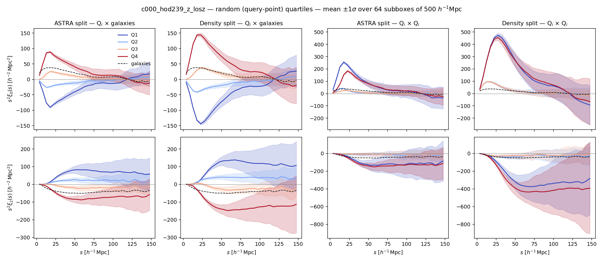

# astra-ds — ASTRA split vs density split on DESI-like HOD mocks

Code and paper for *Environment-dependent galaxy clustering from ASTRA
tessellations: a comparison with density-split clustering on DESI-like mocks*
(H. Nguyen). The paper source is in [`paper/`](paper/).

We measure environment-dependent clustering on AbacusSummit HOD mocks
(DESI LRG-like, z = 0.5) and compare two ways of splitting the density field
into quartiles:

| | ASTRA split | Density split (Paillas et al. 2023) |
|---|---|---|
| environment of a point | `r = (N_data - N_rand)/(N_data + N_rand)` over its Delaunay neighbours in the joint galaxy + random tessellation | Gaussian-smoothed (R = 10 Mpc/h) galaxy density contrast at the point |
| scale | adaptive (nearest neighbours) | fixed smoothing radius |
| evaluated on | full periodic 2 Gpc/h box (30 Mpc/h periodic padding around each subbox) | full periodic 2 Gpc/h box (FFT smoothing) |

Both are evaluated on **the same random points**, so the two classifications
can be compared point by point.



## What is measured

Each 2 Gpc/h box is cut into **64 subboxes of 500 Mpc/h**. In each subbox (open
volume, Landy–Szalay, fixed line of sight, ℓ = 0, 2, 4, s ∈ [0, 150] Mpc/h in
5 Mpc/h bins):

* `gg` — galaxy 2PCF;
* `{astra,ds}_{data,rand}_{auto,cross}_q{1..4}` — for each method and population
  (galaxies ranked by their environment, or random query points ranked by
  theirs; equal-count quartiles, Q1 = most underdense): quartile
  auto-correlation and cross-correlation with all galaxies.

* **Covariance**: 64 subboxes × 3 lines of sight of the fiducial c000 catalogue
  (`hod239`, the draw closest to the centre of the HOD prior), Hartlap-corrected.
* **Derivatives** w.r.t. ω_b, ω_cdm, n_s, σ₈: paired differences (same subbox,
  same line of sight, same phase, same randoms) between HOD-matched catalogues
  of the AbacusSummit derivative grid (`config/hod_selection.json`).
* **Fisher** forecasts with the derivative-noise bias subtracted.

## Baseline analysis of the paper

* **DESI-like (AbacusSummit)**: emulator trained on 999 catalogues with the
  pair-difference loss (`models_pairs/`), covariance of the 1786 official
  DESI small boxes, fiducial point = official best-fit HOD:
  `python scripts/compare_methods.py --models-dir models_pairs --validation-tag _pairs --compress --cov covbox --fiducial official`
* **Quijote**: parameter subsets (Om, s8) and (Om, ns, s8), combined
  (Coulton & Wandelt 2023) Fisher estimator, reliability criterion
  compressed/standard < 1.5: `scripts/quijote_fisher.py`, `scripts/summarize_quijote.py`
* **Inference**: `scripts/mcmc.py` + `scripts/summarize_mcmc.py`

Every other configuration (single-box covariance, other fiducials, regression
derivatives, all Quijote subsets) is a robustness test; see Appendix C of
the paper for the path that led to these choices. Heavy products (`data/`,
`models*/`) are not versioned; on NERSC they live in
`/pscratch/sd/h/hugon/astra-ds-store/` (symlinked) and can be regenerated with
the commands of Appendix A.

## Installation

On NERSC everything needed (numpy, scipy, pandas, fitsio, pycorr/Corrfunc,
matplotlib) is in the DESI environment:

```bash
source /global/common/software/desi/users/adematti/cosmodesi_environment.sh main
```

Elsewhere: `pip install numpy scipy pandas fitsio matplotlib` and
[pycorr](https://github.com/cosmodesi/pycorr) with Corrfunc.

## Reproducing the paper

```bash
python scripts/select_hods.py                       # HOD-matched catalogues -> config/hod_selection.json

# measurements: one catalogue x line of sight = one full CPU node, ~8 min
sbatch slurm/run_catalog.sbatch 0 239 z --los z     # batch queue, or all at once on interactive nodes:
salloc -N 4 -C cpu -q interactive -t 01:30:00 -A desi bash slurm/run_all_interactive.sh z x y

python scripts/plot_multipoles.py data/c000_hod239_z_losz.npz   # Figs. 1-3
python scripts/derivatives.py                                    # derivative figures
python scripts/fisher.py                                         # Fisher tables and figures
sbatch slurm/robustness.sbatch                                   # robustness tests
scripts/make_paper_figures.sh && make -C paper                   # paper/main.pdf
```

The HOD catalogues are read from
`/pscratch/sd/n/ntbfin/emulator/hods/z0.5/yuan23_prior/c{cosmo}_ph000/seed0/hod{NNN}.fits`.
Positions `X_PERP, Y_PERP, Z_RSD` (redshift space) or `Z_PERP` (real space) are
already Alcock–Paczynski rescaled and are used as is; other lines of sight
permute the axes so that the line of sight is always the last one.

## Repository layout

```
astra_ds.py              the method: loading, subboxes, ASTRA, density split, clustering
analysis.py              data vectors, covariance, paired derivatives, Fisher
scripts/
  select_hods.py         HOD-matched catalogues for the derivatives
  run_catalog.py         measure one catalogue -> data/c{cosmo}_hod{hod}_{space}_los{los}.npz
  plot_multipoles.py     ASTRA vs DS multipoles, comparison of the classifications
  derivatives.py         paired central differences + figures
  fisher.py              Fisher forecasts: 2PCF vs ASTRA split vs density split
  robustness.py          padding, number of randoms, thinning
  make_paper_figures.sh  copy the figures into paper/figures
slurm/                   batch and interactive job scripts
config/                  cosmology table, HOD selection
paper/                   LaTeX source of the paper
```

## Lessons from a first version of the pipeline

A first version (in the `acm` fork) averaged the statistics over many
`hodNNN` files and measured them in the central 500 Mpc/h cube only. It is
documented in Appendix B of the paper; in short:

1. `hod000…hod499` are 500 *different HOD models*, not realisations: their
   scatter (~55 % on ξ₀) swamped the cosmological signal (~1 %) — the old
   derivatives were compatible with noise.
2. Pair counts assumed periodic boundaries in a non-periodic cut box.
3. The 2PCF used the mid-point line of sight from the box centre, erasing the
   quadrupole.
4. Quartiles were computed jointly on galaxies + randoms (unequal, realisation-
   dependent sizes).
5. The Delaunay triangulation of the cut box had edge effects.
6. ASTRA was first run on randoms alone, so the random quartiles carried no
   information on the galaxies.

## License

MIT — see [LICENSE](LICENSE).
